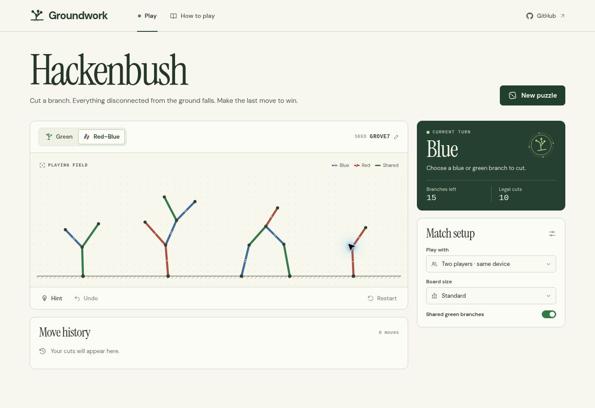

# Hackenbush

**[Play Hackenbush in your browser](https://sodium-qed.github.io/hackenbush/)**

Play **Green Hackenbush** or **Red–Blue Hackenbush** on a randomly generated graph. In Red–Blue, turn on shared green branches to play with all three colors.

Cut one branch on your turn. Every branch that loses its connection to the ground falls, while a branch with a second path to the ground stays. The first player who cannot cut loses, even if the other player's branches are still standing.



## Play

- **Two players** share a screen and take turns.
- **Vs. computer** gives you the first move against a computer opponent.
- **Turn links** let two people play on different devices. Make one move, copy the resulting link, and send it to the other player. Each link carries the puzzle and move history. Send the final link to share the result.

Use **New puzzle** for another board, or open the seed control to replay a particular position. The interactive field guide includes a practice cut. The board works with a mouse, touch, and keyboard.

## Run locally

Serve the static files with Python 3 and open the local address.

```sh
python3 -m http.server 8000 --directory dist
```

Open <http://localhost:8000>. Run the rules, generator, strategy, and turn-link checks with Node.js 20 or later.

```sh
node --test tests/*.test.mjs
```

The game runs in the browser. Turn links work without accounts or a game server. The typefaces in `dist/fonts` include their Open Font Licenses.
